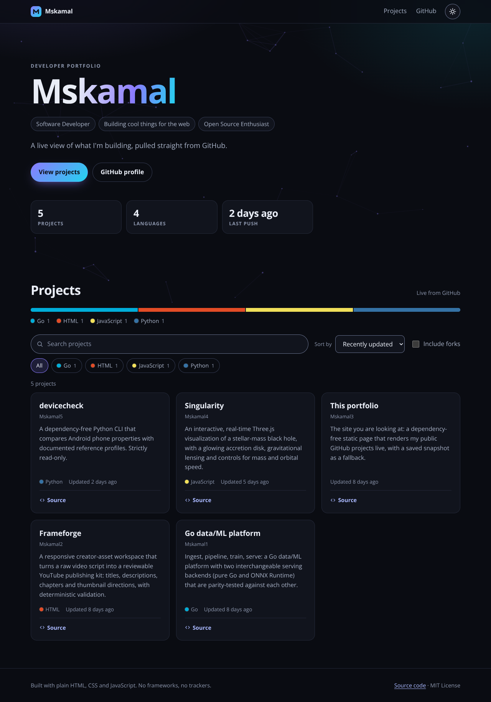
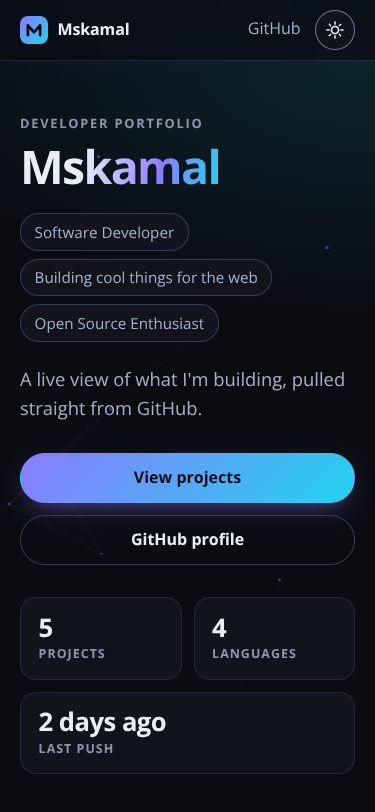

# Mskamal3

Software Developer | Building cool things for the web | Open Source Enthusiast

A one-page portfolio that shows my public GitHub projects. It is plain HTML, CSS and JavaScript:
no framework, no build step and no trackers. The only network request it makes besides its own
files is to the public GitHub API.

<p align="center">
  
  
</p>

_Screenshots were taken from the live site on 4 November 2026._

## What it does

- **Live projects.** Repositories are fetched from the GitHub API in the visitor's browser, so the
  page is always current without a rebuild.
- **Never empty.** If GitHub is unreachable or the anonymous rate limit is hit, the page falls back to
  a recent cached copy and then to a snapshot committed in this repository, and says so with a
  _Try again_ button.
- **Find things fast.** Search, filter by language, sort by recent activity, stars or name, and
  optionally include forks.
- **Light and dark themes.** Follows the system setting, remembers an explicit choice and applies it
  before the first paint, so there is no flash of the wrong theme.
- **Accessible.** Keyboard friendly, with a skip link, visible focus, live-region announcements,
  `prefers-reduced-motion` support and checked colour contrast.
- **Locked down.** A strict Content-Security-Policy (no inline scripts or styles, requests only to
  this site and `api.github.com`) and no third-party code.

## Getting started

You need [Node.js](https://nodejs.org/) 22.13 or newer (24 works too). There is nothing to build.

```sh
npm ci
npm run dev        # http://localhost:4173
```

The dev server is a small dependency-free static server that only listens on `127.0.0.1` unless you
ask otherwise:

```sh
node scripts/serve.mjs --port 8080            # another port
node scripts/serve.mjs --host 0.0.0.0         # reachable from other devices or containers
HOST=0.0.0.0 PORT=8080 npm run dev            # the same, through environment variables
```

It serves files from the repository only: dot-files, `node_modules`, `..` segments and symbolic links
that lead outside the project are refused.

## Configuration

Everything you would edit lives in [`site.config.json`](site.config.json):

| Key                   | Meaning                                                                                                                                            |
| --------------------- | -------------------------------------------------------------------------------------------------------------------------------------------------- |
| `username`            | The GitHub account whose public repositories are shown.                                                                                            |
| `hiddenRepos`         | Repository names to leave out, for example profile repositories. Matched ignoring case.                                                            |
| `ignoredDescriptions` | GitHub descriptions to treat as empty, so a repository that reuses the profile tagline does not repeat it. Compared ignoring case and punctuation. |
| `projects`            | Optional `title` and `description` per repository name, used instead of the GitHub text. Matched ignoring case.                                    |
| `backdrop`            | `false` turns off the animated background. Defaults to `true`.                                                                                     |

A typo is reported clearly instead of rendering nonsense, and `npm test` fails if `projects` or
`hiddenRepos` name a repository that is not in the snapshot.

The titles and descriptions in `projects` are my own short summaries of each repository. Edit them
freely.

## How the data loads

1. A copy fetched from GitHub in the last 10 minutes is used straight away (`localStorage`).
2. Otherwise the page asks `api.github.com` for up to 300 repositories, with a 10 second timeout.
3. If that fails, an older cached copy is shown, with a notice.
4. If there is none, [`data/repos.snapshot.json`](data/repos.snapshot.json) is shown, with a notice.
5. Only if even that is missing does the page show an error, with links to GitHub.

### Refreshing the snapshot

The snapshot is the last-resort fallback, so refresh it now and then and commit the result:

```sh
npm run snapshot                      # rewrites the file only if a repository changed
npm run snapshot -- --force           # always rewrite, updating the timestamp
GITHUB_TOKEN=... npm run snapshot     # optional: a token raises the API rate limit
```

The token is read only by this script. It is never written to the snapshot and never reaches the
browser.

## Project layout

```text
index.html                 the page (all behaviour lives in assets/js)
site.config.json           what to show (see Configuration)
data/repos.snapshot.json   fallback copy of the repository list
assets/css/styles.css      design tokens, light and dark themes, layout
assets/js/                 core logic without DOM access (config, github, repos, format)
                           plus the UI (app, render, theme, backdrop)
scripts/serve.mjs          local static server
scripts/snapshot.mjs       refreshes the snapshot from the GitHub API
tests/                     unit and integration tests
docs/                      screenshots used by this README
```

## Quality checks

```sh
npm run lint     # ESLint
npm test         # Node's built-in test runner, with jsdom
npm run check    # both
```

The tests cover the data logic, the renderer, the whole page running in jsdom against stubbed network
responses (including offline, rate-limited and empty cases), theming, the animated background, the
static HTML contract (security policy, accessibility basics, local references), the dev server, the
snapshot script, the shipped configuration and snapshot, and the WCAG contrast of every colour pair
in both themes, computed from the real stylesheet.

GitHub Actions runs lint and the tests on Node 22 and 24 for every push to `main` and every pull
request ([`ci.yml`](.github/workflows/ci.yml)).

Two further checks were run by hand during development and are **not** part of CI: the page in
headless Chromium (layout from 320 to 1920 px, theming, the offline fallback, the security policy)
and an axe-core audit of WCAG 2.x A and AA rules, which found no violations. Their scripts are not
in this repository.

## Publishing

The site is static and uses only relative URLs, and `.nojekyll` makes GitHub Pages serve the files
as they are. To publish it, open _Settings → Pages_ and choose _Deploy from a branch_, branch `main`,
folder `/ (root)`. It then works from `https://<user>.github.io/Mskamal3/` as well as from a custom
domain.

## License

This repository is licensed under the [MIT License](LICENSE).
